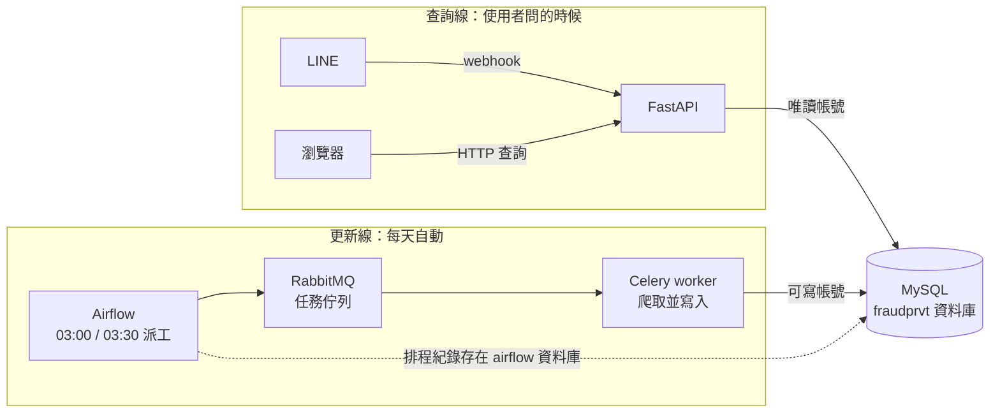

# 詐騙文章查詢 LINE Bot （建置中）

平時多看詐騙案例有助避免被騙～
收集 MyGoPen 的查核文章，與臺灣內政部警政署的各縣市每日案例，存進 MySQL；提供以關鍵字查詢查核文章的功能。另外，收集臺灣獲 IFCN 認證的 Taiwan FactCheck Center（台灣事實查核中心）的查核文章（規劃中），以及每天主動傳送一則「每日案例」給使用者（規劃中）。

> 目前狀態：資料收集與每日自動更新（由 Airflow 排程）已在本機 Docker Swarm 上運作；LINE 串接已在本機透過 ngrok 驗證可收發訊息；雲端部署尚在進行。

## 這個專案做什麼

- 每天自動爬取 MyGoPen 最新查核文章，存入 `mygopen_articles`（含分類 `article_categories`）。
- 每天自動增量更新內政部警政署的各縣市每日案例，存入 `fraud_cases`（目前 API 尚未使用）。
- FastAPI 提供查詢介面，並以 LINE webhook 讓使用者在 LINE 傳關鍵字查詢（已在本機以 ngrok 驗證，尚未部署到雲端）。
- 截至 2026-10-16：`mygopen_articles` 162 筆、`fraud_cases` 200,387 筆。

## 資料來源

- MyGoPen 查核文章。
- 內政部警政署的各縣市每日案例。
- 資料與文章內容的權利屬各來源網站，本專案為學習用途。

## 架構與資料流



資料庫帳號依用途分開：API 只有讀取權限，爬蟲帳號只能寫入爬蟲負責的資料表；帳號名稱由 `.env.stack` 設定。

Airflow 以兩個 DAG 每天送出任務（時區 Asia/Taipei：03:00 MyGoPen、03:30 警政署案例）。
Airflow 自己的中繼資料存在同一個 MySQL 的 `airflow` 資料庫；它內部另有一個 Redis，
與負責爬蟲任務的 RabbitMQ 是兩套各自獨立的佇列。

## 本機執行

需求：Docker Desktop，並啟用 Swarm。

```bash
git clone https://github.com/pz-chn/fraudprvt.git
cd fraudprvt

# 1. 設定環境變數（密碼請自行設定，勿使用任何範本或課堂提供的帳密）
cp .env.stack.example .env.stack     # 依欄位填寫（包含 Airflow 管理員密碼，請用隨機字串）
cp .env.line.example .env.line     # 填入 LINE 的 Channel secret 與 access token（不進 git）

# 2. 建置 image
docker build -t fraudprvt_api:local services/api
docker build -t fraudprvt_crawler:local services/crawler
docker build -t fraudprvt_airflow:local services/airflow

# 3. 部署
docker swarm init                    # 若尚未啟用 Swarm
set -a; source .env.stack; source .env.line; set +a
docker stack deploy --resolve-image never -c stack.yml fraudprvt

# 4. 資料表與資料庫帳號：全新環境不需手動處理
#    MySQL 第一次啟動、資料目錄為空時，會自動執行 db/schema.sql（建立資料表）
#    與 db/init-users.sh（建立專用帳號與 airflow 資料庫）。
#    若資料目錄已存在（例如以前啟動過），初始化不會再執行，請見下方「注意事項」。

# 5. 開啟 Airflow（http://localhost:8082，帳號為 .env.stack 的 AIRFLOW_ADMIN_USER）
#    把 crawler_crawl_mygopen 與 crawler_crawl_165_recent 兩個 DAG 的開關打開。
#    打開時會立刻補跑一次，之後每天自動執行。
#    也可以用下列指令手動觸發一次爬取：
docker exec $(docker ps -q -f name=fraudprvt_crawler_worker) \
  uv run celery -A crawler.worker call crawler.tasks_schedule.crawl_mygopen
```

資料庫專用帳號（api、crawler、airflow）與 `airflow` 資料庫，會在 MySQL 第一次啟動、資料目錄為空時，由 `db/init-users.sh` 依 `.env.stack` 的變數（`API_DB_ACCOUNT`／`API_DB_PASSWORD`、`CRAWLER_DB_ACCOUNT`／`CRAWLER_DB_PASSWORD`、`AIRFLOW_DB_ACCOUNT`／`AIRFLOW_DB_PASSWORD`）自動建立；資料表結構由 `db/schema.sql` 自動建立。以上步驟尚未用乾淨的 clone 完整驗證過一遍。

### 注意事項

1. 初始化腳本（`/docker-entrypoint-initdb.d/`）只在 MySQL 資料目錄為空時執行一次，對已有資料的資料庫沒有作用。
2. 新增資料表時，要同時做兩件事：在 `db/init-users.sh` 補上對應的 `GRANT`（讓新環境正確），並在現有資料庫手動執行同樣的 `GRANT`（讓現有環境正確）。
3. 各帳號權限採「預設拒絕」：新資料表預設沒有任何帳號能使用，必須明確授權。

## 本機測試 LINE（ngrok）

LINE 的 webhook 需要公開的 HTTPS 網址。本機測試時用 ngrok 把網址轉到本機的 API（8889 埠）。

事前準備（只需做一次）：

- 在 LINE Developers 建立 Messaging API channel，把 Channel secret 與 access token 填進 `.env.line`（不進 git）。
- 安裝 ngrok、登入，並設定 authtoken：`ngrok config add-authtoken <你的 authtoken>`（authtoken 不要放進 repo）。
- 在 ngrok dashboard 的 Domains 領一組固定網域。

每次測試：

```bash
# 1. 確認 mysql 與 api 服務是 1/1
docker stack services fraudprvt

# 2. 啟動 ngrok（固定網域；舊版 ngrok 的參數是 --domain）
ngrok http --url=<你的固定網域> 8889
```

3. 到 LINE Developers → Messaging API，Webhook URL 填 `https://<你的固定網域>/callback`，按 Verify，並確認 Use webhook 是開啟的（固定網域只需設定一次）。
4. 用手機在 LINE 傳關鍵字（例如「詐騙」）測試。
5. 測完在 ngrok 的終端機按 Ctrl+C。

注意：ngrok 開著時，任何人拿到網址都能連到 API，測完請關閉。

## 專案結構

```
fraudprvt/
├── stack.yml                 # Swarm stack：所有服務的定義
├── db/schema.sql             # 資料表結構
├── db/init-users.sh          # MySQL 首次初始化時建立專用帳號與 airflow 資料庫
├── .env.stack.example        # 部署用環境變數欄位（只有欄位名稱）
└── services/
    ├── airflow/              # Airflow（Dockerfile、dags/）
    ├── api/                  # FastAPI（Dockerfile、pyproject.toml、api/）
    └── crawler/              # Celery 爬蟲（crawler/ 任務、migrations/、Dockerfile）
```

## 作者與來源

作者：pz-chn。本專案以 TibaMe 資料工程班的課程範本為起點延伸開發。
